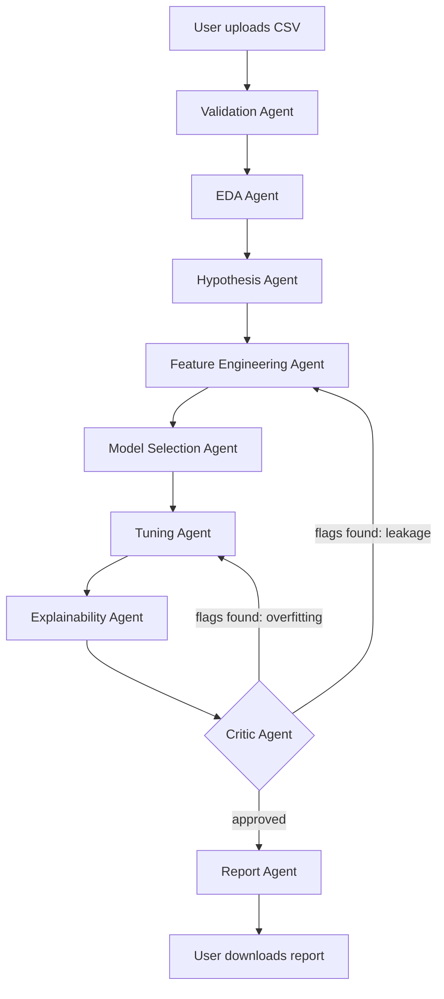
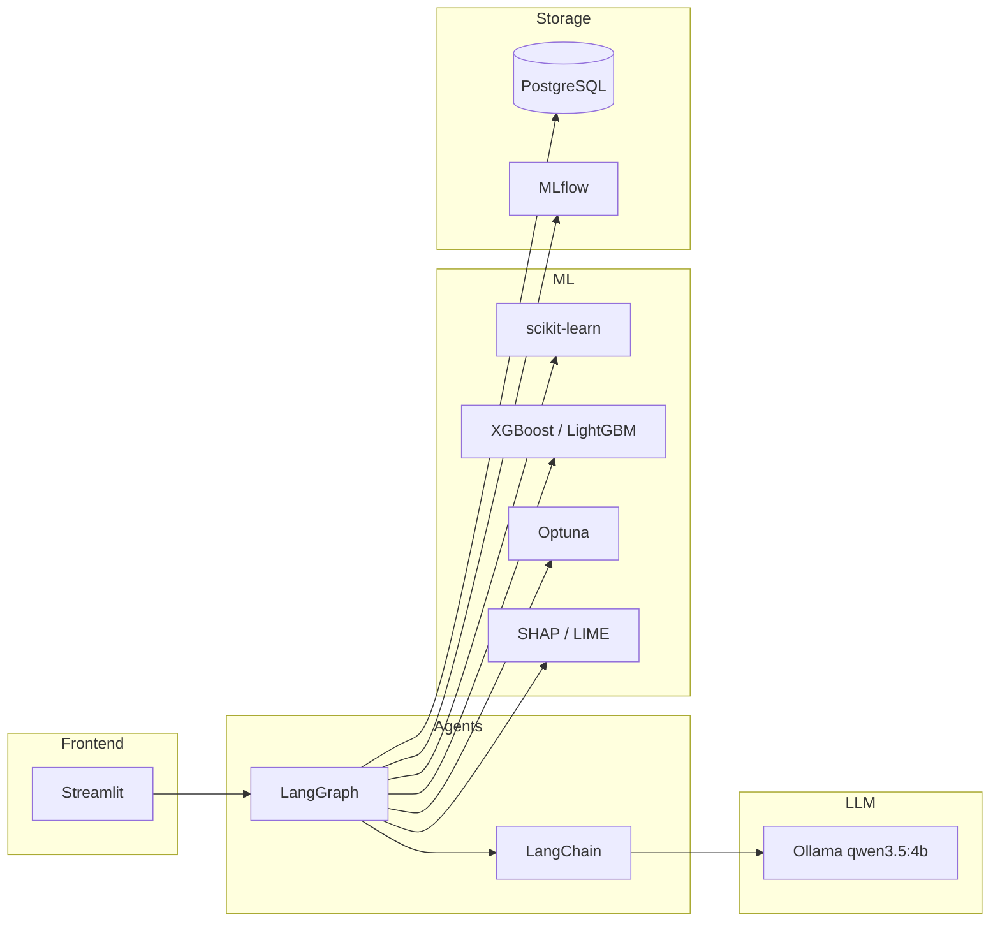

# AgentLab

A multi-agent system that automates the machine learning workflow: from a raw dataset to a trained model, an explainability report, and a written research report, with a critic agent that checks the results before anything is finalized.

Unlike a standard AutoML pipeline that runs a fixed sequence of steps, AgentLab splits the workflow across independent agents that each own one job, and adds a critic agent that can send the process back a step if something looks wrong (a leaked feature, an overfit model, a suspicious result). That loop-back mechanism is the project's actual research question: does letting a system critique and revise its own work produce better results than a pipeline that just runs top to bottom.

## Status

This is a working scaffold, not a finished system. Read this table honestly before assuming something works.

| Agent | Status | Notes |
|---|---|---|
| Validation Agent | Built and tested | Runs standalone, 4 passing unit tests |
| EDA Agent | Stub | Spec written in docstring, week 3-4 |
| Feature Engineering Agent | Stub | Week 3-4 |
| Hypothesis Generation Agent | Stub | Week 8-9 |
| Model Selection Agent | Stub | Week 5-6 |
| Tuning Agent | Stub | Week 5-6 |
| Explainability Agent | Stub | Week 7 |
| Critic Agent | Stub | Week 8-9 — the actual research contribution, don't rush this |
| Report Agent | Stub | Week 10 |
| Graph wiring (`graph/workflow.py`) | Reference code only | Week 11, wire in once every agent above works standalone |
| Streamlit frontend | Upload page works, rest are placeholders | Week 11 |

## System architecture



The critic's loop-back is the only conditional branch in the graph. Every other edge is a fixed sequence, same as a standard pipeline would run. That contrast is what the project is testing.

## Tech stack



| Layer | Choice | Why |
|---|---|---|
| Agent orchestration | LangGraph | Manages shared state between agents and supports conditional loops, which the critic agent needs |
| LLM | Ollama, `llama3.2:3b` | Runs fully local, zero API cost, zero rate limits, fits a 4GB VRAM GPU comfortably (~2.0GB) |
| Modeling | scikit-learn, XGBoost, LightGBM | Standard, well-understood baselines, easy to defend in a viva |
| Tuning | Optuna | Automated hyperparameter search on top of whichever model wins |
| Explainability | SHAP, LIME | Turns predictions into feature-level reasons, the core differentiator vs plain AutoML |
| Experiment tracking | MLflow | Free run comparison dashboard without building one from scratch |
| Database | PostgreSQL | Real client-server database, not a flat file, stores experiment history |
| Frontend | Streamlit | Fast to build, good enough for a demo-quality interface |

## Folder structure

```
agentlab/
├── agents/            one file per agent, each independently testable
│   ├── base_agent.py       shared contract every agent follows
│   └── validation_agent.py the only fully built agent right now
├── graph/             LangGraph state definition + the wiring that connects agents
├── database/          PostgreSQL models and connection handling
├── memory/            experiment memory (past runs), used by the Model Selection Agent
├── ml/                shared ML code: preprocessing, training, explainability, MLflow logging
├── prompts/           prompt templates, kept separate from agent logic
├── frontend/          Streamlit app and pages
├── data/              uploaded and processed datasets (gitignored)
├── reports/           generated reports land here (gitignored)
├── tests/             unit tests, one file per agent
└── docs/              architecture notes, filled in as the project progresses
```

## Setup

### 1. Python environment

Use Python 3.11. Newer versions work with some libraries but 3.11 is the version every dependency here (SHAP in particular) supports cleanly with no edge cases.

```bash
python3.11 -m venv venv
source venv/bin/activate
pip install -r requirements.txt
```

### 2. Ollama (local LLM)

```bash
# install Ollama: https://ollama.com/download
ollama pull llama3.2:3b
ollama serve   # leave this running in a separate terminal
```

Every agent's LLM calls go through this local model. If `ollama serve` isn't running, agents fall back to a plain templated summary instead of crashing, but you'll want the real model running for anything beyond a structural test.

### 3. PostgreSQL

```bash
# create a local database matching .env
createdb agentlab
# or, with Docker:
docker run --name agentlab-pg -e POSTGRES_USER=agentlab -e POSTGRES_PASSWORD=agentlab -e POSTGRES_DB=agentlab -p 5432:5432 -d postgres
```

### 4. Environment file

```bash
cp .env.example .env
# defaults already match the Ollama + Postgres setup above, edit only if yours differs
```

### 5. Initialize the database tables

```bash
python -c "from database.db import init_db; init_db()"
```

## Running things

**Validation agent standalone:**
```bash
python -m agents.validation_agent path/to/your/dataset.csv
```

**Unit tests:**
```bash
pytest tests/ -v
```

**Streamlit frontend** (once more agents are built):
```bash
streamlit run frontend/app.py
```

## Build order

Follow this order, don't jump ahead, each phase assumes the previous one actually works.

1. Validation Agent — done
2. EDA Agent + Feature Engineering Agent
3. Model Selection + Tuning Agent (Optuna)
4. Explainability Agent (SHAP + LIME)
5. Hypothesis Generation Agent
6. Critic Agent — the actual research contribution, budget real time here
7. Report Agent
8. Wire everything into `graph/workflow.py`
9. Streamlit frontend
10. Testing, documentation, buffer

## The research question this project is actually testing

Run every test dataset through the pipeline twice: once with the Critic Agent active, once with it stubbed to always approve. Compare final model quality and explainability soundness between the two runs. That comparison, across at least 3-4 different datasets, is the real evidence behind this project's claim, not a mathematical proof. Document results in `docs/architecture.md` as they come in.
